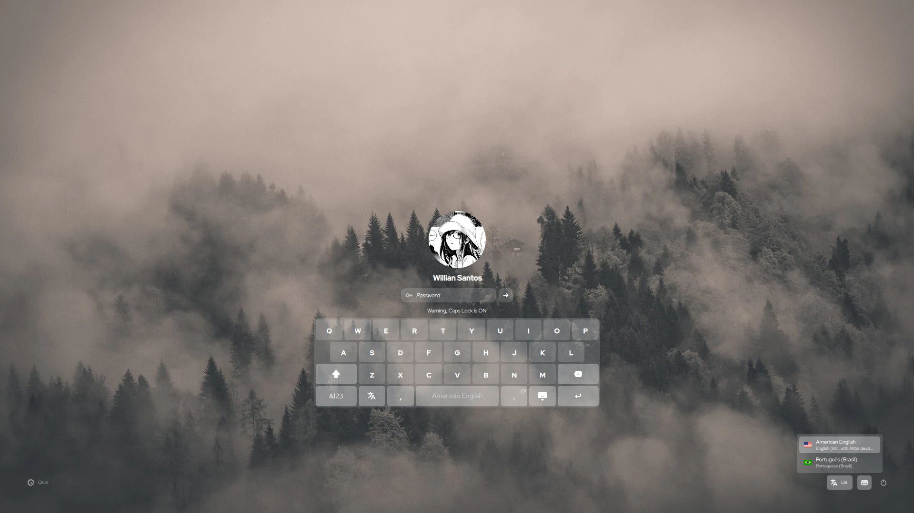

# Lingmo SDDM 主题

Lingmo OS 的 SDDM 登录主题：锁屏 + 登录双界面，支持静态/动态（视频）壁纸、背景
模糊/亮度/饱和度可调，**200 多个配置项**，内置 16 套预设配色（Catppuccin、Nord、
Everforest、Gruvbox、Eldritch 等）。

**本项目基于 [SilentSDDM](https://github.com/uiriansan/SilentSDDM) 开发**（原作者 uiriansan，GPL-3.0-or-later）。
Lingmo OS 在其基础上做了品牌化、中文翻译与 Debian 打包。



## 依赖

要求 **SDDM ≥ 0.21** 与 **Qt ≥ 6.5**（用到 `QtQuick.Effects` 的 `MultiEffect`）。
Debian / Ubuntu 上需要的包：

```bash
sudo apt install sddm \
    qml6-module-qtquick qml6-module-qtquick-window qml6-module-qtquick-controls \
    qml6-module-qtquick-layouts qml6-module-qtquick-effects qml6-module-qtmultimedia \
    qml6-module-qtquick-virtualkeyboard libqt6svg6 qt6-image-formats-plugins
```

主题自带的 **Red Hat Display** 字体安装到 `/usr/share/fonts/truetype/redhat-display/`。

## 安装

### 方式一：Debian 包（推荐）

```bash
sudo apt install ./sddm-theme-lingmo_1.5.0.lingmo.1_all.deb
```

### 方式二：手动安装

```bash
sudo mkdir -p /usr/share/sddm/themes/lingmo
sudo cp -rf . /usr/share/sddm/themes/lingmo/
sudo cp -r fonts/redhat fonts/redhat-vf /usr/share/fonts/
```

## 启用

主题需要两项 greeter 全局设置。**请不要直接改 `/etc/sddm.conf`** —— 发行版里其它
主题也会写这个文件，会互相覆盖。放一个 `/etc/sddm.conf.d/` 片段：

```bash
sudo mkdir -p /etc/sddm.conf.d
sudo tee /etc/sddm.conf.d/10-lingmo-theme.conf >/dev/null <<'EOF'
[General]
InputMethod=qtvirtualkeyboard
GreeterEnvironment=QML2_IMPORT_PATH=/usr/share/sddm/themes/lingmo/components/,QT_IM_MODULE=qtvirtualkeyboard

[Theme]
Current=lingmo
EOF
```

**重启 SDDM 之前务必先测试**（配置写错会进不去登录界面）：

```bash
/usr/share/sddm/themes/lingmo/test.sh
```

测试通过后再：

```bash
sudo systemctl restart sddm
```

## 配置

所有配置项在 `configs/` 下，切换预设只需改 `metadata.desktop` 里的 `ConfigFile=`：

```ini
ConfigFile=configs/default.conf
```

可选预设：`default`、`default-left`、`default-right`、`rei`、`ken`、`silvia`、
`everforest`、`gruvbox`、`nord`、`catppuccin-latte`、`catppuccin-frappe`、
`catppuccin-macchiato`、`catppuccin-mocha`、`eldritch-cthulhu`、`eldritch-abyss`、
`eldritch-dusk`。也可以复制一份预设再改。

完整的配置项说明见 [上游 wiki](https://github.com/uiriansan/SilentSDDM/wiki/Customizing)；每个选项在
`components/Config.qml` 里都带有 `@desc:` 注释，可直接查阅。

## 翻译

已内置 **简体中文（zh_CN）** 与 **繁体中文（zh_TW / zh_HK）**：

```
translations/zh_CN.ts   源文件（可翻译文案用 qsTr() 包裹）
translations/zh_CN.qm   编译产物，SDDM 按 metadata.desktop 的
                        TranslationsDirectory 自动加载
```

新增可翻译文案后重新生成并编译（需要 `lupdate6` / `lrelease6`，来自 `qt6-l10n-tools`）：

```bash
./update_translations.sh
```

## 打包

仓库自带 `debian/`：

```bash
dpkg-buildpackage -b -us -uc
# 产出 ../sddm-theme-lingmo_<版本>_all.deb
```

打包要点：

- `translations/*.qm` 在**构建时**由 `lrelease6` 从 `.ts` 生成
  （`Build-Depends: qt6-l10n-tools`），源码里不需要提交编译产物；
- 字体安装到 `/usr/share/fonts/truetype/redhat-display/`；
- **不修改 `/etc/sddm.conf`**，改用 `/etc/sddm.conf.d/` 片段（详见 `debian/README.Debian`）；
- 安装目录为 `/usr/share/sddm/themes/lingmo/`，与旧主题包 `lingmo-sddm-theme`
  的目录相同，因此本包声明 `Conflicts`/`Replaces` 取代它。若希望两个主题**共存**，
  需要改掉其中一个的目录名与 `Theme-Id`。

## 版权与致谢

- 本项目**基于 [SilentSDDM](https://github.com/uiriansan/SilentSDDM) 开发**，原项目版权归作者 uiriansan 及
  其贡献者所有，许可证 **GPL-3.0-or-later**；
- 随主题分发的 **Red Hat Display** 字体遵循 **SIL Open Font License 1.1**
  （见 `fonts/OFL.txt`）；
- 品牌化、中文翻译与 Debian 打包由 **Lingmo OS Team** 完成。

完整版权信息见 `debian/copyright`。
